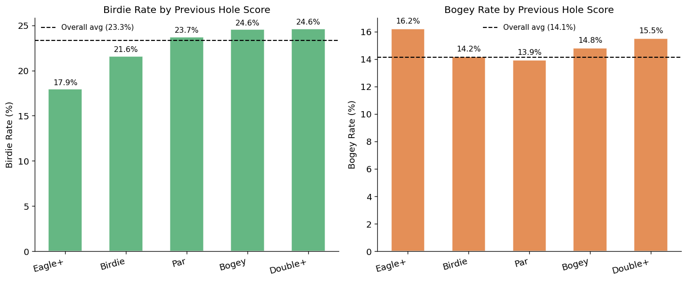
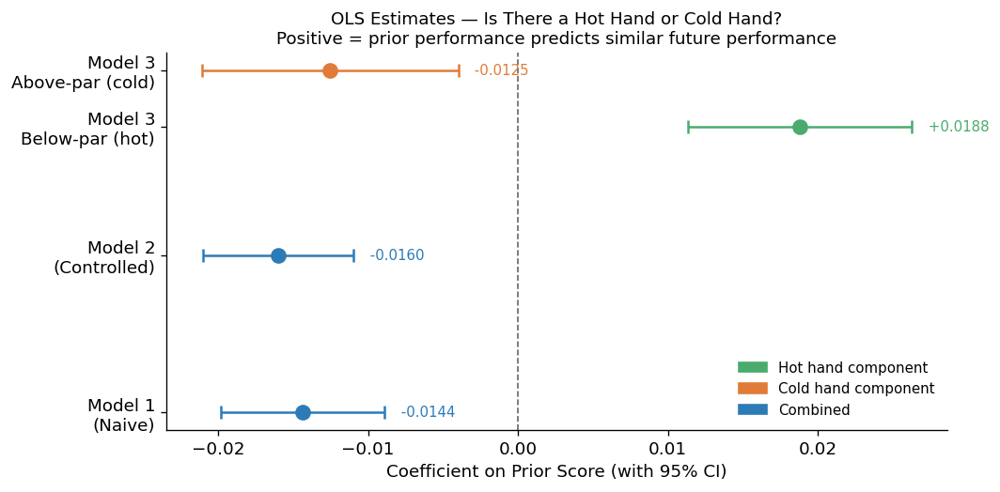

# The Bounce-Back Effect: momentum on the PGA Tour

Does a birdie make the next birdie more likely? Across **130,499 consecutive hole pairs** from 246 players in 22 marquee PGA Tour events (2020–2024), the answer is no. Golf at this level is **mean-reverting**: a good hole predicts a slightly worse next hole, and a bad hole predicts a slightly better one.

- After a birdie, the odds of another birdie drop about 10% (odds ratio 0.897, p < 0.001), controlling for hole difficulty and player quality.
- After a bogey, the odds of a birdie rise about 14% (odds ratio 1.136, p < 0.001).
- 180 of the 190 players with at least 8 rounds have negative within-round autocorrelation. Mean streakiness is −0.077 (t = −21.5).
- Streakiness doesn't predict scoring. Regressing a player's average score to par on their streakiness gives p = 0.73.

The full write-up is [The Bounce-Back Effect (PDF)](The%20Bounce-Back%20Effect%20_%20Charlie%20Hubbard.pdf).

## Method

This replicates the framework of Arkes (2016), *The hot hand vs. cold hand on the PGA Tour*, on newer data.

1. **Data.** Five seasons of schedules, leaderboards and hole-by-hole scores from ESPN's public golf API, for the top 30 finishers at about 15 marquee events per year. That is 138,229 hole scores. Only truly consecutive holes within a round are kept, so a good finish on Saturday can't "predict" a good start on Sunday.
2. **Controls.**
   - *Hole difficulty:* the field's average score on that hole, in that round, at that event.
   - *Player quality:* each player's average score across the dataset.
3. **Three OLS models** with HC3 robust standard errors:
   - a naive lag;
   - a lag plus controls;
   - the Arkes split, where the previous hole's below-par and above-par components enter separately. This tests the hot hand and the cold hand as independent hypotheses.
4. **Logistic regressions** for birdie→birdie, bogey→bogey, birdie→bogey and bogey→birdie.
5. **Per-player streakiness** (average within-round lag-1 autocorrelation), tested against zero and against tournament performance.

| Model 3 term | Coefficient | p | Reading |
|---|---|---|---|
| Below-par previous hole | +0.0188 | < 0.001 | a good hole is followed by a slightly *worse* one |
| Above-par previous hole | −0.0125 | 0.004 | a bad hole is followed by a slightly *better* one |
| Hole difficulty | +0.996 | < 0.001 | |
| Player average | +0.341 | < 0.001 | |

**Compared with Arkes (2016):** Arkes found a cold hand and no hot hand in 2003–2013 ShotLink data for the top 200 players. Here, both effects point toward the average. Likely reasons:
- a more elite sample (top 30 at marquee events);
- an era of mental-performance coaching;
- a smaller sample (130k vs. about 2.8M holes), which leaves less power to detect a cold hand.

## Repository

| File | What it does |
|---|---|
| [`GHH_01_data_collection.ipynb`](GHH_01_data_collection.ipynb) | Pulls schedules, leaderboards and hole-by-hole scores from ESPN with retry and rate limiting; writes parquet files to `data/` |
| [`GHH_02_hot_hand_analysis.ipynb`](GHH_02_hot_hand_analysis.ipynb) | Feature engineering, transition matrix, OLS and logistic models, player streakiness, figures |

**Run it:** `pip install requests pandas pyarrow numpy scipy statsmodels matplotlib seaborn`, then run notebook 01 (about 20–30 minutes of API calls) and notebook 02. Notebook 02 was written for Colab and reads from Google Drive; point the three `read_parquet` paths at `data/` to run it locally.

## Limitations

- ESPN's hole-level data covers marquee events only, and only the top 30 finishers were pulled. That selects on good weeks, which could itself pull toward mean reversion. Pulling full fields is the next check.
- The player-average control uses the full sample, including the hole being predicted.
- The logistic models use binary prior-hole flags, so they show the direction of the effect, not its precise size.
